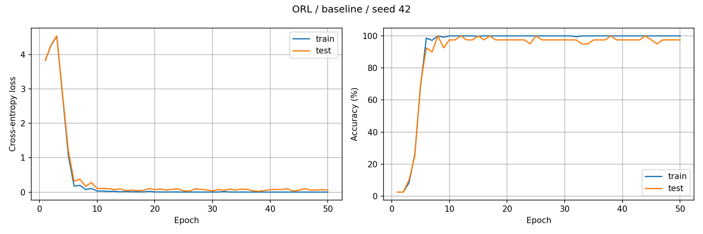
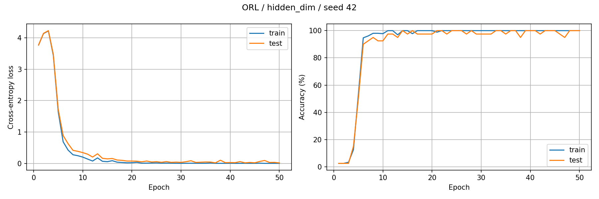
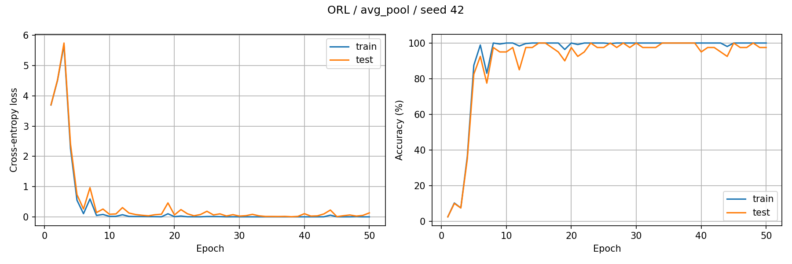
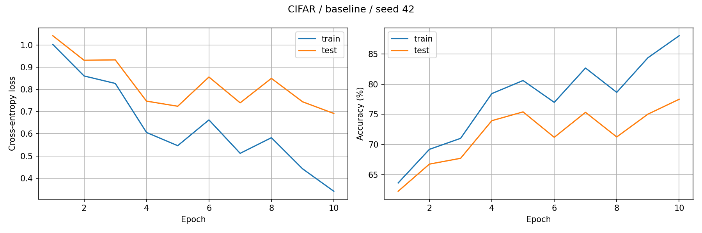
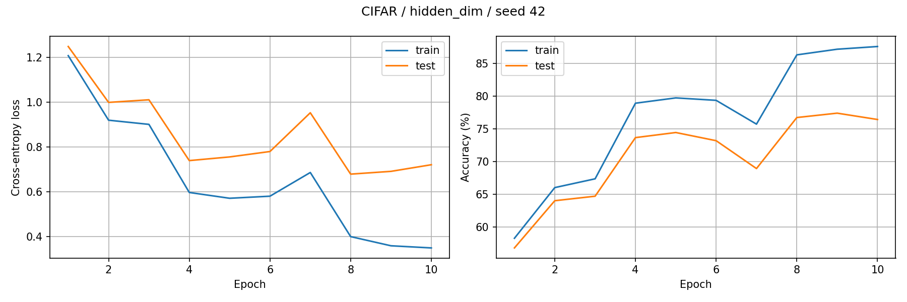
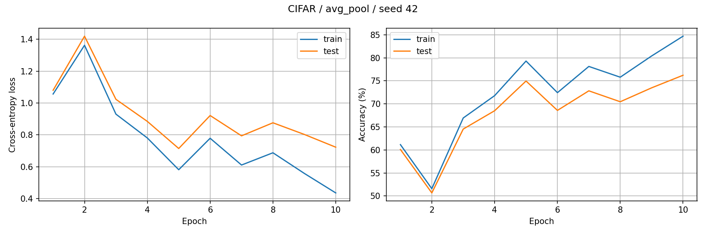

# Stage 3.5 results

Final epoch, not the best test epoch. Accuracy is percent; delta is percentage points.

| Dataset | Experiment | Hidden | Pool | Train acc (%) | Test acc (%) | Delta (pp) | Macro F1 | Seconds |
|---|---|---:|---|---:|---:|---:|---:|---:|
| ORL | baseline | 256 | max | 100.00 | 97.50 | +0.00 | 0.9667 | 116.5 |
| ORL | hidden_dim | 128 | max | 100.00 | 100.00 | +2.50 | 1.0000 | 112.1 |
| ORL | avg_pool | 256 | avg | 100.00 | 97.50 | +0.00 | 0.9667 | 112.1 |
| CIFAR | baseline | 128 | max | 87.99 | 77.49 | +0.00 | 0.7726 | 83.3 |
| CIFAR | hidden_dim | 256 | max | 87.61 | 76.45 | -1.04 | 0.7626 | 82.8 |
| CIFAR | avg_pool | 128 | avg | 84.69 | 76.21 | -1.28 | 0.7596 | 85.0 |

## Learning curves

### ORL / baseline

### ORL / hidden_dim

### ORL / avg_pool

### CIFAR / baseline

### CIFAR / hidden_dim

### CIFAR / avg_pool

